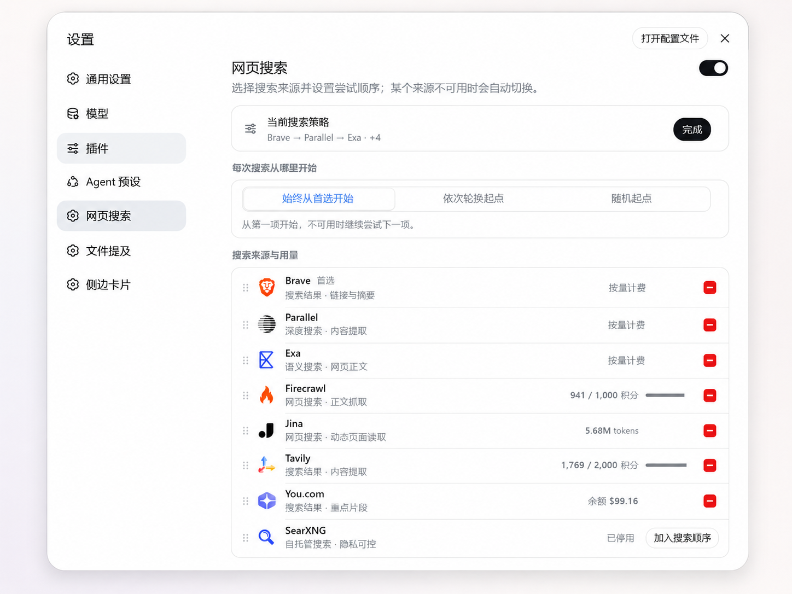
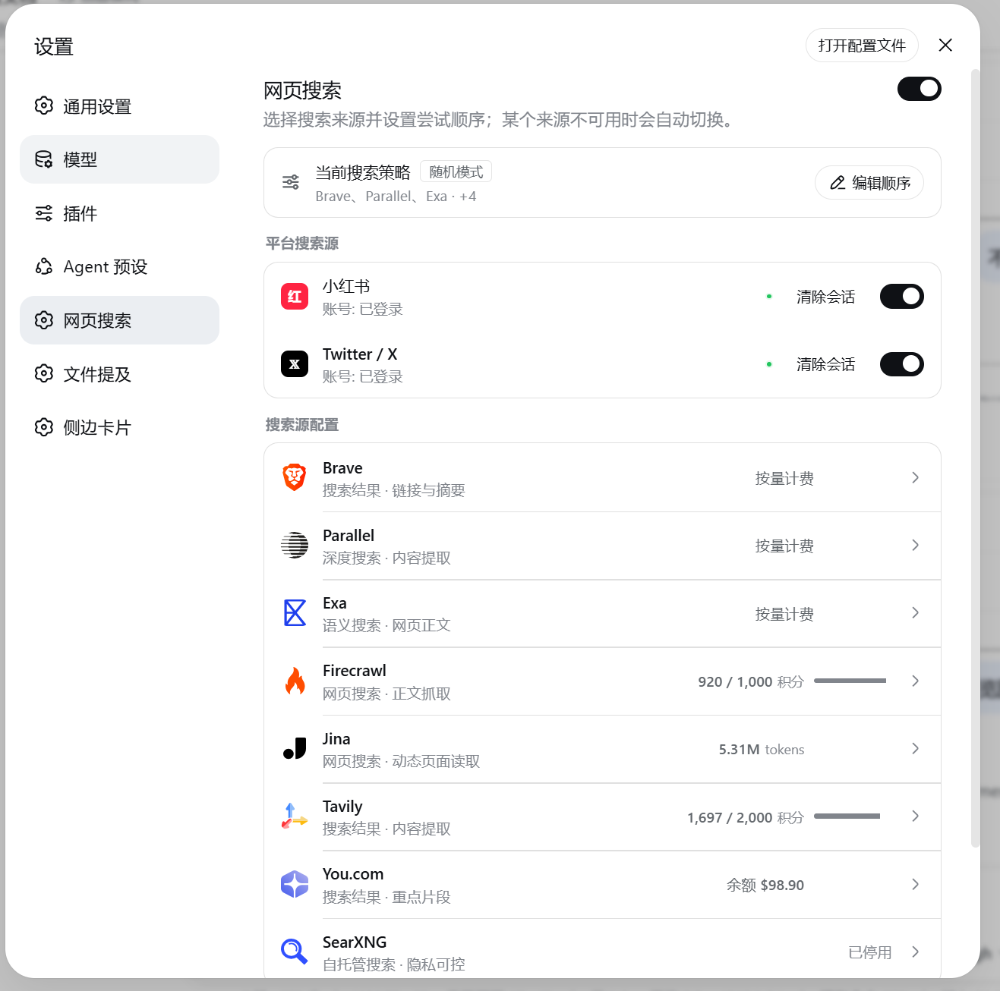

<div align="center">

<p align="center">
  
</p>

# dsh-web-tools

An all-in-one smart web search and multi-source retrieval layer for DeepSeek Harness.

**Native-Capability Adaptation Across 10 Providers · Hedged & Fused Retrieval · Xiaohongshu & Twitter / X Sessions · Standalone MCP Server**

<p align="center">
  <a href="https://github.com/A3Boy/dsh-web-tools/stargazers">
    
  </a>
  <a href="LICENSE">
    
  </a>
  <a href="https://github.com/deepseek-ai/deepseek-harness">
    
  </a>
  
</p>

**English** | [简体中文](README.zh-CN.md)

</div>

## Release History

| Version | Date | Highlights |
| :--- | :--- | :--- |
| **v0.4.0** | 2026-11-09 | • **Retrieval Upgrades**: Added Hedged and Fused (RRF) concurrent retrieval, plus Adaptive and Cost-Tier routing<br/>• **Ecosystem**: Decoupled standalone stdio MCP server (for Cursor / Claude Code), plus Serper (Google) adapter<br/>• **Experience**: Long-document TOC outlines, `Alt+S` composer shortcut, and >70% faster startup |
| **v0.3.9** | 2026-11-07 | Integrated Keenable search with `site` domain scoping and date range filtering. |
| **v0.3.5** | 2026-11-01 | Custom search providers with 3 parallel access paths and SSRF defense; native Xiaohongshu and Twitter / X browser session retrieval. |

For detailed change logs, see [CHANGELOG.md](CHANGELOG.md).

---

## Why dsh-web-tools?

When building agentic workflows, relying on a single search API often introduces three critical bottlenecks:

1. **Single Points of Failure**: A single quota exhaustion, 429 rate limit, or transient network error halts the entire retrieval workflow.
2. **Flattened Capabilities**: Simple multi-provider proxies typically compress all backends into the lowest common denominator, throwing away the specialized strengths of each engine (e.g., Exa's neural categories, Brave's LLM Context, Tavily's chunking & depth levels, Firecrawl's GitHub filters, Keenable's summary extracts).
3. **Social Media Blind Spots**: General search engines cannot access signed-in user notes, discussion threads, and comments on platforms like Xiaohongshu or Twitter / X.

**dsh-web-tools bridges this gap**: It integrates seamlessly into DSH's standard `web_search` and `web_fetch` tools. Using deterministic **SearchHints**, it compiles agent query intents directly into provider-native parameters without additional LLM latency. It adds multi-key pooling, circuit breakers, hedged/fused retrieval, and native social sessions to deliver a resilient, high-density retrieval layer.

```text
                         DSH Agent / MCP Client
                                   │
                        web_search / web_fetch
                                   │
                                   ▼
                              SearchHints
                 topic / freshness / domains / locale ...
                                   │
                 ┌─────────────────┴─────────────────┐
                 ▼                                   ▼
     Web Providers (10+ Native Adapters)     Social Platforms (Native Sessions)
  Exa / Tavily / Firecrawl / Serper ...       Xiaohongshu / Twitter (X)
                 │                                   │
  ┌──────────────┼──────────────┐             (Dedicated Browser Profile)
  ▼              ▼              ▼                    │
Single        Hedged          Fused             Authentic Posts / Comments Tree
(Default)    (Fast/Reliable) (High Recall)           │
  └──────────────┬──────────────┘                    │
                 ▼                                   ▼
        Normalized High-Quality Results & Clean Markdown (with Auto TOC)
```

<p align="center">
  
</p>

---

## Key Features

- **10 Native-Capability Search Adapters**: Tailored parameter compilation for Exa, Tavily, Firecrawl, Parallel, Brave, You.com, Jina, Keenable, Serper (Google Search), and SearXNG.
- **Resilient Multi-Source Concurrent Retrieval**:
  - **Single**: Sequential fallback, cheapest quota usage.
  - **Hedged**: Launches a secondary provider if the primary exceeds 1.2s; the first responder wins and cancels the rival, cutting tail latency without doubling spend on fast queries.
  - **Fused**: Queries two providers simultaneously and merges results with Reciprocal Rank Fusion (RRF) for high-recall scenarios.
- **6 Intelligent Routing Policies**: Supports **Ordered**, **Round-Robin**, **Random**, plus metrics-driven **Adaptive** (ranked by 24h success rate & latency), **Fastest**, and **Cheapest** (cost tier prioritization).
- **Social Platform Discovery (Xiaohongshu & Twitter / X)**: Direct connections via dedicated local browser profiles with zero extensions and zero heavy bundled binaries. Safely parses authentic posts, images, and full nested comment trees.
- **Long-Document Structured Outline (TOC)**: Automatically analyzes Markdown headings for documents exceeding 8,000 characters and prepends an interactive Table of Contents outline to help LLMs navigate long context efficiently.
- **Focused Page Reading (`web_read`)**: Deterministic BM25 passage ranking and section outline extraction for web pages. Returns only high-relevance passages and structural outlines within a strict character budget, with `section` and `contentId` progressive reading to navigate long articles without context bloat.
- **Custom Search Providers & One-Click Presets**: Declarative integration for in-house knowledge bases or arbitrary REST APIs, with ready-to-use presets for Serper, SearXNG, Elasticsearch/OpenSearch, and Tavily-compatible gateways.
- **Enterprise-Grade Outbound Protection (SSRF Defense)**: Safe public egress, explicit confirmation prompts for private networks, and transport-level hard blocking of cloud metadata (169.254 / IMDSv6) and link-local ranges.
- **Multi-Level Fault Tolerance**: Multi-API-key pooling, 429 cooldown windows, circuit breakers, short-lived result caching, and in-flight request deduplication.
- **Standalone MCP Server**: Decoupled engine available as a standard stdio MCP server for Cursor, Claude Code, Windsurf, or any external AI agent.
- **Composer Search Mode Control**: Clean toggle in the chat input (Smart, Always, Off) with `Alt+S` keyboard shortcut for rapid switching.

---

## Quick Start

### 1. Installation

Run inside your DSH environment:

```bash
# Install plugin
dsh plugin --profile web add github:A3Boy/dsh-web-tools

# Upgrade plugin
dsh plugin --profile web update dsh-web-tools
```

### 2. Configuration

Restart DSH Web (`dsh web`), and open the left sidebar: **Settings** → **Web Search**.

- Enter your API keys for any providers you own (e.g. Tavily, Exa, Serper, Brave; self-hosted SearXNG requires no key).
- Enable your desired providers and drag to adjust fallback priority.
- Click **Test Search** under any provider to verify network connectivity and response latency.

### 3. Usage in Chat

Works out of the box with zero model prompt modifications:
- **Shortcut**: Press `Alt+S` in the chat input box to cycle through Smart (auto), Always (enforced), and Off (hard isolation).
- **Social Search**: Prefix queries with `小红书:` or `X:` (e.g. `X: DeepSeek Harness architecture discussions`) to route to dedicated social platform sessions.

---

## Advanced Retrieval & Routing

### 1. Concurrent Retrieval Modes

Configure how providers are queried in the settings panel:

- **Single (Default)**: Tries providers sequentially. If the primary fails, times out, hits 429, or returns 0 results, it cascades to the next healthy provider. Lowest API consumption.
- **Hedged**: Dispatches to the primary provider. If no response arrives within 1.2s, a secondary provider starts concurrently. Whichever settles first wins; the slower lane is immediately aborted. Preserves fast response times without wasting quota on swift queries.
- **Fused**: Queries two providers in parallel and merges their ranked lists using **Reciprocal Rank Fusion (RRF)** with URL deduplication. Displays a "Fused" badge on combined results.

### 2. 6 Starting Routing Policies

- **Ordered**: Always begins with the primary provider in your configured chain.
- **Round-Robin**: Rotates starting providers evenly across requests.
- **Random**: Randomly selects an enabled, healthy provider.
- **Adaptive**: Dynamically ranks providers based on a 24-hour rolling window of success rate and p95 latency.
- **Fastest**: Prioritizes providers with the lowest average response latency.
- **Cheapest**: Dispatches by cost tier (self-hosted SearXNG -> low-cost APIs -> metered deep extraction).

### 3. Standalone MCP Server (Cursor / Claude Code)

The core retrieval engine can be used independently outside DSH as a standard stdio MCP server:

```bash
# Run via installed binary
dsh-web-tools-mcp

# Or run directly from source repository
npm install && npm run build
node bin/mcp-server.js
```

Exposes standard `web_search`, `web_fetch`, and `web_read` tools. Credentials are read from standard environment variables (`EXA_API_KEY`, `TAVILY_API_KEY`, `SERPER_API_KEY`, etc.), and routing policies can be configured via `WEB_TOOLS_ROUTING_POLICY`.

---

## Focused Page Reading (`web_read`)

DSH's built-in `web_fetch` injects an entire web page (up to 200,000 characters) directly into model context. For long documentation, research papers, or deep technical articles, this risks saturating the context window and diluting focus.

**`web_read`** provides focused reading through deterministic, LLM-free BM25 passage ranking:

- **Deterministic BM25 Relevance**: Ranks Markdown sections against an optional `focus` query using CJK bigrams and Latin tokens. Only the top-scoring excerpts and a structural outline are returned within the budgeted character limit.
- **Progressive Continuation**: Models can inspect the returned outline and progressively read any section in full by passing `section: "<id>"` (e.g. `section: "s3"`).
- **Drift Prevention (`contentId`)**: Returns an 8-character Sha256 `contentId` for the fetched content. When reading a section, passing `contentId` ensures that remote page edits or live updates won't quietly drift section identifiers.
- **Shared Cache & Security**: Reuses the plugin's 5-minute fetch cache and enterprise SSRF defense, avoiding duplicate network calls when reading multiple sections.
- **Search Mode Policy Integration**: Automatically hidden and blocked alongside `web_search` and `web_fetch` when search mode is switched to `off`.

### Tool Parameters

| Parameter | Type | Required | Description |
| :--- | :---: | :---: | :--- |
| `url` | string | **Yes** | Web page URL (`http://` or `https://`). |
| `focus` | string | No | Specific question or keywords to rank passages. Omit to read from the start of the page. |
| `maxChars` | number | No | Character budget (500–20,000, default: 6,000). |
| `section` | string | No | Section id from a previous outline (e.g. `"s2"`) to read that section in full. |
| `contentId` | string | No | Content identifier from a previous call to ensure continuity across dynamic page updates. |

### Configuration

- `webReadEnabled` (boolean, default: `true`): Enable or disable the `web_read` tool registration.

---

## Social Platform Sources (Xiaohongshu & Twitter / X)

Unlike third-party scraper relays, this plugin uses a **dedicated local browser profile architecture**:

- **No Heavy Bundles or Extensions**: Uses the local Edge or Chrome browser already installed on your system. Zero extra downloads of multi-hundred-megabyte Chromium binaries; zero browser extensions.
- **Secure Credential Isolation**: Cookies and session state reside in isolated local profile storage and are never written to configuration files or sent to third-party servers.
- **Structured Deep Parsing**:
  - **Xiaohongshu**: Enters authentic search interfaces to extract note details, image counts, and hierarchical comment trees with nested replies.
  - **Twitter / X**: Intercepts native GraphQL data streams to extract tweets, quotes, media, and multi-level reply trees.

<p align="center">
  
</p>

---

## Provider Support Matrix

| Provider | Search | Fetch / Extract | Specialized Native Capabilities | Quota & Usage |
| :--- | :---: | :---: | :--- | :--- |
| **[Exa](https://exa.ai)** | Yes | Yes | Neural semantic search, category mapping, query highlights, ISO date & domain scoping | Provider console |
| **[Tavily](https://tavily.com)** | Yes | Yes | Depth levels, chunking control, news/finance topic mapping, geo & domain filters | Real-time API check |
| **[Serper](https://serper.dev)** | Yes | — | Real-time Google Search, `answerBox` quick answers, `tbs` freshness, geo & language targeting | Provider console |
| **[Firecrawl](https://firecrawl.dev)** | Yes | Yes | Coding queries mapped to `github`, research to `research`, clean Markdown extraction | Real-time API check |
| **[Parallel](https://parallel.ai)** | Yes | Yes | Dual-layer semantic search, `objective` soft-steering, `source_policy` filters | Provider console |
| **[Brave](https://brave.com/search/api/)** | Yes | — | Priority LLM Context pre-extracted summaries, freshness & regional filters | Header inspection |
| **[Keenable](https://keenable.ai)** | Yes | Yes | `site` domain scoping and date range filters; native page extraction (`/v1/fetch`) | Header & local usage ledger |
| **[You.com](https://you.com)** | Yes | Yes | Search highlights, native `boost_domains` soft-weighting, freshness & country filters | Real-time API check |
| **[Jina](https://jina.ai)** | Yes | Yes | Query noise reduction, ReaderLM-v2 high-precision Markdown conversion | Header inspection |
| **[SearXNG](https://docs.searxng.org)** | Yes | — | Self-hosted meta-search, category & time-range filters, keyless access | Self-hosted instance |

> **Page Fetching Note**: When a provider supporting extraction (Tavily, Exa, Firecrawl, Keenable) is configured, its cloud API is used first. If unconfigured or failing, requests seamlessly fall back to the **built-in generic fetcher** (powered by local Defuddle Markdown parsing with automatic TOC outline for long articles).

---

## Frequently Asked Questions (FAQ)

### 1. SearXNG returns 403 or empty results?
Ensure JSON format output is enabled in your SearXNG instance:
- Edit `settings.yml` inside your SearXNG container and add `- json` under `search.formats`:
  ```yaml
  search:
    formats:
      - html
      - json  # Must be enabled for API consumption
  ```
- Restart the container. In the settings panel, fill in the instance address (e.g. `http://127.0.0.1:8080`) and leave the API Key blank.

### 2. Why do long articles read faster and more reliably?
The plugin incorporates an automatic outline generator: whenever fetched content exceeds 8,000 characters, the generic fetcher builds and prepends a Markdown Table of Contents (TOC) outline. This gives models an immediate high-level map of the document, reducing hallucination and context confusion.

### 3. Does multi-source search consume extra quota?
- **Single**: Only consumes 1 request per query (cascades only on failure or 0 results).
- **Hedged**: If the primary source responds within 1.2s, the secondary source is never called. If invoked, the winning lane aborts the loser immediately to minimize waste.
- **Fused**: Queries two providers simultaneously to merge and re-rank results, consuming two requests.

---

## Local Development & Testing

```bash
npm install          # Install dependencies
npm test             # Run 520+ unit and integration tests
npm run typecheck    # Strict TypeScript type check
npm run build        # Compile to lib/
```

---

## License

[MIT](LICENSE) © A3Boy
