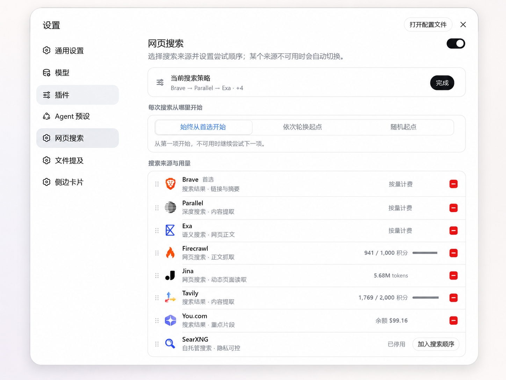
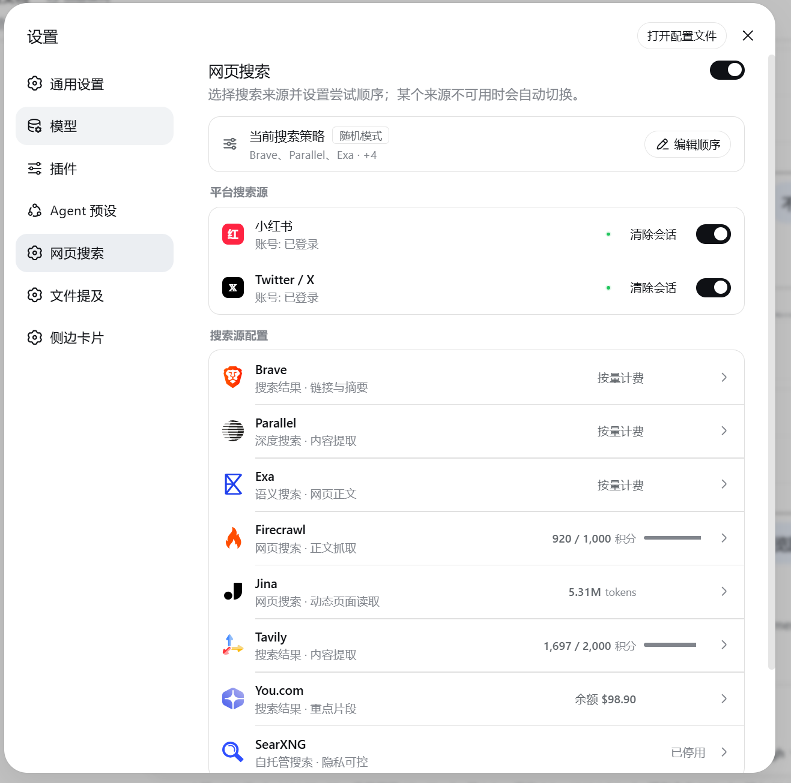

<div align="center">

<p align="center">
  
</p>

# dsh-web-tools

**Reliable multi-provider web search and page reading for DeepSeek Harness (DSH) and MCP clients**

Automatic provider failover · Custom JSON search APIs · Focused page reading (`web_read`) · Local Xiaohongshu & X sessions · Standalone MCP server

<p align="center">
  <a href="https://github.com/A3Boy/dsh-web-tools/releases">
    
  </a>
  <a href="LICENSE">
    
  </a>
  
  
</p>

**English** | [简体中文](README.zh-CN.md)

</div>

---

> [!WARNING]
> **Xiaohongshu & Twitter / X Account Risk Notice**
> Xiaohongshu search drives your signed-in local browser window to search, scroll, and paginate. Because the platform actively monitors automated behavior, **frequent or bulk queries can get your account rate-limited or banned**. Always **use a secondary account, keep query frequency low, and use with caution**. Twitter / X is similarly subject to per-account rate limits. You can disable either platform anytime in Settings.

## What It Does

Connecting an AI agent to the web usually runs into four practical headaches:

1. **Single-provider fragility**: One exhausted quota, `429` rate limit, or network hiccup breaks the whole turn.
2. **Hard-to-wire custom APIs**: Connecting self-hosted SearXNG, Zhipu BigModel, Bocha, Elasticsearch, or an internal search gateway normally requires writing custom glue code.
3. **Long pages blow up context**: Fetching a 100k-character documentation page via `web_fetch` burns tokens and buries the actual answer in boilerplate.
4. **Social media blind spots**: Standard search APIs cannot read Xiaohongshu notes/comments or full X conversation threads.

`dsh-web-tools` solves these in one package:

- **Three model tools**: `web_search` (multi-source search), `web_fetch` (clean full-page Markdown), and `web_read` (relevant passages + page outline within a character budget).
- **10 built-in providers + custom endpoints**: Built-in support for Exa, Tavily, Serper (Google), Brave, Firecrawl, Keenable, You.com, Jina, Parallel, and SearXNG — plus a visual editor with one-click presets for Zhipu BigModel, Bocha, Elasticsearch, and custom REST JSON APIs.
- **Automatic failover & multi-key rotation**: Rotates across multiple API keys per provider, cools down failing backends, and falls back cleanly when a source times out or returns zero results.
- **Works inside DSH or standalone via MCP**: Ships both as a native DSH Web plugin and as a standard stdio MCP server (`dsh-web-tools-mcp`) for Cursor, Claude Code, Claude Desktop, and Windsurf.

---

## Quick Start

### Option 1: Use inside DeepSeek Harness (DSH)

```bash
# Install the plugin
dsh plugin --profile web add github:A3Boy/dsh-web-tools

# Update to the latest version later
dsh plugin --profile web update dsh-web-tools
```

Restart `dsh web` and open **Settings → Web Search** in the sidebar:

1. Click any search source to paste your API key(s) (self-hosted SearXNG needs no key by default).
2. To add a custom gateway or domestic API (such as Zhipu BigModel or Bocha), click **Add Custom Search Source**, pick a preset at the top, enter your key, and click **Test Search**.
3. Drag sources to set your preferred order, or switch routing and concurrency modes under **Current search strategy**.

**In-chat controls:**
- **Switch search mode (`Alt+S` or `/search`)**:
  - **Smart (Default)**: The agent decides when a web lookup is needed and answers directly otherwise.
  - **Always**: Enforces at least one web tool call before finishing each turn.
  - **Off**: Hides web tools from the session and blocks calls at the tool gate (your chosen mode is preserved when resuming past sessions).
- **Target social platforms**: Prefix a query with `小红书:` or `X:` (for example, `X: SQLite WAL benchmark`) to route through your local platform session (**use a secondary account and low frequency for Xiaohongshu**).

<p align="center">
  
</p>

---

### Option 2: Standalone MCP Server (Cursor / Claude Code / Windsurf)

You can run `dsh-web-tools` outside DSH as a standalone stdio MCP server. Install directly from GitHub or build from source:

```bash
# Method A: Global install from GitHub
npm install -g github:A3Boy/dsh-web-tools
dsh-web-tools-mcp

# Method B: Clone and build locally
git clone https://github.com/A3Boy/dsh-web-tools.git
cd dsh-web-tools
npm install && npm run build
node bin/mcp-server.js
```

#### Cursor / Claude Desktop Configuration

Add to `.cursor/mcp.json` or `claude_desktop_config.json` (configure only the API keys you have):

```json
{
  "mcpServers": {
    "web-tools": {
      "command": "dsh-web-tools-mcp",
      "env": {
        "TAVILY_API_KEY": "tvly-...",
        "EXA_API_KEY": "...",
        "SERPER_API_KEY": "...",
        "WEB_TOOLS_DEFAULT_PROVIDER": "tavily",
        "WEB_TOOLS_ROUTING_POLICY": "adaptive",
        "WEB_TOOLS_RETRIEVAL_STRATEGY": "hedged"
      }
    }
  }
}
```

If running from a local clone, replace `"command": "dsh-web-tools-mcp"` with `"command": "node", "args": ["/path/to/dsh-web-tools/bin/mcp-server.js"]`.

#### Claude Code CLI

```bash
claude mcp add web-tools -- dsh-web-tools-mcp
```

---

## Core Capabilities

### 1. Focused Page Reading (`web_read`)

Instead of dumping an entire 80k-character reference page into context with `web_fetch`, `web_read` splits Markdown into structural chunks and ranks them locally with BM25 (no extra LLM calls, a few milliseconds of CPU):

- **Step 1 — Ask with a focus**: `web_read(url, focus: "how WAL checkpointing works")` returns the lead context, the highest-scoring passages within your character budget (default `6,000` chars), a full section outline (`s0`, `s1`, `s2`...), and an 8-char SHA-256 `contentId`.
- **Step 2 — Read a specific section**: Pass `web_read(url, section: "s2", contentId: "...")` on a follow-up call to read that section in full. If the live page changed in between, `contentId` catches the mismatch so the agent refreshes the outline instead of reading shifted text.
- Short pages that already fit within `maxChars` are returned whole.
- You can toggle `web_read` on or off anytime under **Connection test & timeout** in Settings.

### 2. Multi-Source Routing & Concurrency

Click **Edit** on **Current search strategy** to choose how queries are dispatched:

**Concurrency modes:**
- **Single (Default)**: Tries one source at a time and moves to the next on errors, timeouts, or empty results. Lowest quota use.
- **Hedged**: Starts your primary source first; if it has not answered after **1.2s**, starts the next source in parallel. First responder wins and cancels the slower request — fast queries spend 1 request, slow queries avoid long stalls.
- **Fused**: Queries two sources in parallel and merges results via Reciprocal Rank Fusion (RRF). Best coverage, uses 2 requests per search.

**Starting source policies:**
- **Ordered**: Always starts from the top of your list.
- **Round-robin / Random**: Spreads traffic across enabled sources.
- **Adaptive**: Ranks sources automatically using rolling 24h success rate and latency.
- **Fastest / Cheapest**: Picks the lowest-latency source first, or prioritizes free self-hosted SearXNG before paid APIs.

Query hints such as recency (`2026`, `latest`, `this week`), `site:github.com`, `-site:example.com`, coding/research topics, and sort order (`time`, `likes`) are translated locally into each provider's native API parameters.

### 3. Custom Search Sources & Presets

Click **Add Custom Search Source** to connect internal search services or regional APIs. Six one-click templates are built in:

1. **Zhipu Web Search (BigModel)** (`open.bigmodel.cn`)
2. **Bocha Web Search** (`api.bochaai.com`)
3. **Serper (Google)** (`google.serper.dev`)
4. **SearXNG** (self-hosted JSON API)
5. **Elasticsearch / OpenSearch** (`/_search` with `multi_match` body template)
6. **Tavily Compatible Gateway**

For arbitrary REST JSON endpoints, switch to **Custom JSON API** to configure headers, URL parameters, or nested JSON body templates (`{{query}}`, `{{maxResults}}`, `{{apiKey}}`) along with response dot-paths (`itemsPath`, `urlPath`, `titlePath`, `snippetPath`).

**Outbound safety:**
- Direct connections validate DNS records upfront and pin the socket to the verified IP, protocol, and port; HTTP `3xx` redirects are refused so API keys never leak across origins.
- Private/LAN targets and plain `http://` require explicit confirmation; cloud metadata endpoints (`169.254.169.254`, IMDSv6, link-local) are unconditionally blocked.
- Respects `HTTPS_PROXY` / `HTTP_PROXY`, Windows system proxy settings, and `NO_PROXY` bypass rules while dialing authorized LAN addresses directly.

### 4. Local Xiaohongshu & Twitter / X Sessions

- **No extra browser downloads**: Connects via CDP to your existing Chrome or Edge installation using isolated profile folders (`~/.dsh/web-tools/browser-profiles/<platform>`), keeping cookies strictly on disk inside your local profile.
- **Xiaohongshu**: Supports sorting (general, latest, likes, comments, collects) and extracts note bodies, images, and loaded comment threads.
- **Twitter / X**: Extracts full tweets, media, and reply trees when signed in; falls back to public syndication / FxTwitter channels for individual status URLs when signed out or temporarily rate-limited in the browser.

> [!CAUTION]
> **Reminder**: Xiaohongshu actively enforces anti-automation limits on logged-in accounts. **Use a secondary account and keep search frequency low.**

<p align="center">
  
</p>

---

## Built-in Provider Matrix

| Provider | Search | Fetch / Extract | Strengths | Quota Display |
| :--- | :---: | :---: | :--- | :--- |
| **[Exa](https://exa.ai)** | Yes | Yes | Strong semantic search for technical docs, papers, and code | Provider console |
| **[Tavily](https://tavily.com)** | Yes | Yes | Agent-focused search & page extraction with depth controls | Live API sync |
| **[Serper](https://serper.dev)** | Yes | — | Fast Google results + `answerBox` direct answers | Provider console |
| **[Brave](https://brave.com/search/api/)** | Yes | — | Uses LLM Context summaries first; freshness & region filters | Response headers |
| **[Firecrawl](https://firecrawl.dev)** | Yes | Yes | Clean Markdown scraping; GitHub & research category filters | Live API sync |
| **[Keenable](https://keenable.ai)** | Yes | Yes | Domain & date-range scoping plus native `/v1/fetch` extraction | Headers + local ledger |
| **[You.com](https://you.com)** | Yes | Yes | Long search highlights and domain soft-boosting | Live API sync |
| **[Jina](https://jina.ai)** | Yes | Yes | ReaderLM-v2 Markdown conversion | Response headers |
| **[Parallel](https://parallel.ai)** | Yes | Yes | Objective-steered search with domain/freshness policies | Provider console |
| **[SearXNG](https://docs.searxng.org)** | Yes | — | Free self-hosted meta-search, no API key required | Self-hosted |

> **Fetch fallback**: When `web_fetch` or `web_read` runs, configured extraction-capable providers (Tavily, Exa, Firecrawl, Keenable) are tried first; if none are configured or extraction fails, the built-in local fetcher (Defuddle + automatic TOC outline for pages over 8,000 chars) handles the page automatically.

---

## MCP Environment Variables

Pass multiple keys for any provider as a comma-separated string (`key1,key2`) to enable automatic key pooling:

| Variable | Description | Default |
| :--- | :--- | :--- |
| `EXA_API_KEY` / `TAVILY_API_KEY` / `SERPER_API_KEY` / `BRAVE_API_KEY` | Provider API key(s) | — |
| `FIRECRAWL_API_KEY` / `KEENABLE_API_KEY` / `YOU_API_KEY` / `JINA_API_KEY` / `PARALLEL_API_KEY` | Provider API key(s) | — |
| `SEARXNG_URL` | Base URL of your self-hosted SearXNG instance | — |
| `WEB_TOOLS_DEFAULT_PROVIDER` | Initial preferred search provider | `exa` |
| `WEB_TOOLS_ROUTING_POLICY` | `ordered` / `round-robin` / `random` / `adaptive` / `fastest` / `cheapest` | `adaptive` |
| `WEB_TOOLS_RETRIEVAL_STRATEGY` | `single` / `hedged` / `fused` | `hedged` |
| `WEB_TOOLS_TIMEOUT_MS` | Per-provider attempt timeout in ms | `10000` |
| `WEB_TOOLS_REQUEST_TIMEOUT_MS` | Overall timeout ceiling per MCP tool call in ms | `60000` |

---

## FAQ

### 1. SearXNG returns `403` or empty results?
SearXNG disables JSON output by default. Enable `json` under `search.formats` in your SearXNG `settings.yml` and restart the container:
```yaml
search:
  formats:
    - html
    - json
```
Then enter your instance URL (e.g. `http://127.0.0.1:8080`) in Settings and leave the API key blank.

### 2. Why did custom HTTPS sources fail with `unapproved authority <host>:0` on v0.3.9?
In `0.3.9`, Undici passed `port: ""` for default HTTPS ports, which the pinned connector coerced to `0` (adding `:443` manually did not help because URL parsing strips default ports). Upgrade to **v0.5.1** and restart DSH — no API key or permission changes needed.

### 3. Does Smart (`auto`) mode inject duplicate prompts every turn?
No. **v0.5.1** checks the effective session history visible to the model: as long as the Smart-mode note is still in context (including across session resume), later turns add nothing. It is only re-inserted if context compaction removes earlier messages or when switching back from **Always** / **Off** (**Off** mode is similarly deduplicated across consecutive turns).

### 4. Does Hedged or Fused search double my API bill?
- **Single**: 1 request per search unless the primary fails.
- **Hedged**: Only starts a second source when the first takes longer than 1.2s, and cancels the slower one immediately.
- **Fused**: Always queries 2 sources in parallel (~2x quota) for broader coverage.

### 5. What does `WEB_READ_PAGE_CHANGED` mean?
If a live page updates between two `web_read` calls, section IDs from the old outline may no longer match. Passing `contentId` catches that change and tells the agent to fetch a fresh outline instead of reading mismatched sections.

---

## Development & Testing

```bash
npm install          # Install dependencies
npm test             # Run 700+ unit and integration tests
npm run typecheck    # Typecheck host and client
npm run build        # Build lib/ outputs
npm run bench:m4     # Run web_read M4 benchmark (see bench/m4/RESULTS.md)
```

## License

[MIT](LICENSE) © [A3Boy](https://github.com/A3Boy)
