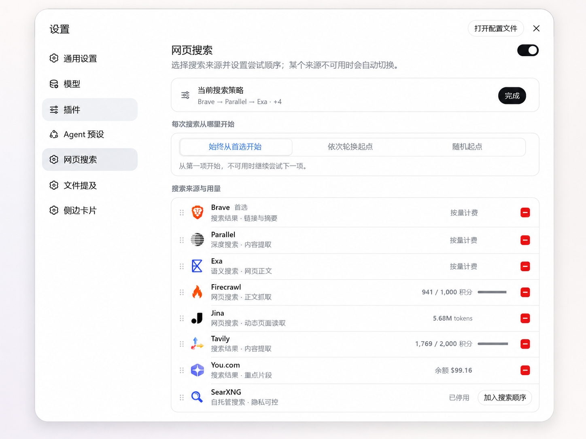

<div align="center">

<p align="center">
  
</p>

# dsh-web-tools

**DeepSeek Harness 与 MCP 智能体生态的下一代多源联网与高密度检索层**

10 大搜索引擎深度原生适配 · 对冲与融合并发检索 · 网页精读 (`web_read`) · 小红书 / Twitter (X) 原生会话 · 独立 Stdio MCP 服务

<p align="center">
  <a href="https://github.com/A3Boy/dsh-web-tools/stargazers">
    
  </a>
  <a href="LICENSE">
    
  </a>
  <a href="https://github.com/deepseek-ai/deepseek-harness">
    
  </a>
  
  
  
</p>

[English](README.md) | **简体中文**

</div>

---

## 目录 (Table of Contents)

- [版本历史 (Release History)](#版本历史-release-history)
- [为什么需要 dsh-web-tools？](#为什么需要-dsh-web-tools)
- [架构设计总览](#架构设计总览)
- [核心特性](#核心特性)
- [快速上手](#快速上手)
  - [1. 在 DeepSeek Harness (DSH) 中使用](#1-在-deepseek-harness-dsh-中使用)
  - [2. 独立 MCP 服务接入 (Cursor / Claude Code / Windsurf)](#2-独立-mcp-服务接入-cursor--claude-code--windsurf)
- [网页精读与降噪 (`web_read`)](#网页精读与降噪-web_read)
- [多源并发检索与智能调度](#多源并发检索与智能调度)
- [社交媒体直连检索 (小红书与 Twitter / X)](#社交媒体直连检索-小红书与-twitter--x)
- [自定义搜索源与一键预设](#自定义搜索源与一键预设)
- [Provider 支持矩阵](#provider-支持矩阵)
- [MCP Server 规范与环境变量](#mcp-server-规范与环境变量)
- [常见问题 (FAQ)](#常见问题-faq)
- [本地开发与基准评测](#本地开发与基准评测)
- [许可证](#许可证)

---

## 版本历史 (Release History)

| 版本 | 发布日期 | 核心更新说明 |
| :--- | :--- | :--- |
| **v0.5.0** | 2026-11-24 | • **网页精读工具 (`web_read`)**：确定性 BM25 算法分块排序与结构大纲提取，长篇技术页面 Token 中位削减 92%–96%（冻结测试集实测，详见 [bench/m4/RESULTS.md](bench/m4/RESULTS.md)）<br/>• **分节续读与防漂移**：支持按大纲章节号 `section` 定向精读，引入 8 位 SHA-256 `contentId` 网页指纹杜绝内容动态漂移<br/>• **M4 真实网页基准测试**：全自动 50 真实用例覆盖与事实召回评测套件，计算时延随页面与预算变化<br/>• **生态扩展**：独立 MCP 服务全面支持 `web_read`；会话联网模式关闭时自动硬隔离 |
| **v0.4 开发功能** | 并入 v0.5.0 发布 | • **并发检索升级**：新增对冲（Hedged 投机竞速）与多源融合（Fused - RRF 倒数排名融合）检索模式<br/>• **智能路由调度**：新增自适应（Adaptive，基于 24h 成功率与 p95 延迟）、最快（Fastest）与最省（Cheapest 成本梯度）路由<br/>• **独立 MCP 服务**：内核完全解耦，支持以标准 stdio MCP 协议供 Cursor、Claude Code、Windsurf 等调用<br/>• **Serper 原生适配**：深度接入 Google 搜索，原生归一化 `answerBox` 快速解答卡片<br/>• **超长文档 TOC 大纲**：超过 8,000 字符的长篇文档自动前置 Markdown 目录大纲 |
| **v0.3.9** | 2026-11-04 | 接入 Keenable 搜索引擎，支持 `site` 域名限定与发布日期范围过滤。 |
| **v0.3.5** | 2026-10-05 | 支持自定义搜索源（三条并列接入路径、JSON 模板与分级出站防护）；支持小红书与 Twitter / X 专用浏览器会话原生检索。 |

完整更新履历请参阅 [CHANGELOG.md](CHANGELOG.md)。

---

## 为什么需要 dsh-web-tools？

在构建大模型 Agent 时，单纯依赖通用搜索 API 往往面临四大瓶颈：

1. **单点脆弱**：单一 API 额度耗尽、限流（429）或遇到网络抖动时，检索流程直接中断。
2. **能力被抹平**：传统聚合层将各 API 降级为最低公共参数，白白丢弃各引擎的核心强项（如 Exa 神经网络分类、Brave 的 LLM Context 预提取摘要、Tavily 深度分块、Firecrawl 的 GitHub 过滤、Keenable 的摘要提取、Serper 的 Google AnswerBox 等）。
3. **上下文爆炸与幻觉**：通用 `web_fetch` 动辄抓取 50,000–200,000 字符的冗长网页全文灌入模型上下文，不仅白白耗费巨量 Token 成本，还会引发大模型“迷失在中间”（Lost in the Middle）与信息检索幻觉。
4. **社媒数据盲区**：常规搜索引擎无法访问小红书、Twitter / X 等强登录态社媒平台内的真实用户笔记与评论讨论树。

**dsh-web-tools 为彻底解决上述问题而设计**：
- **三合一检索工具链**：统一提供 `web_search`（多引擎原生搜索）、`web_fetch`（带长文大纲的正文抓取）与 `web_read`（确定性 BM25 网页精读）。
- **零延迟 SearchHints**：在不消耗额外大模型调用的前提下，将自然语言意图（时效、分类、代码、特定域名、排序）毫秒级编译为各引擎原生参数。
- **企业级高韧性保障**：多 API Key 轮换与健康检查、429 冷却退避、故障断路器、对冲与融合并发检索。
- **真实社媒直连**：基于系统已有浏览器（Edge / Chrome）的本地专用 Profile 直连小红书与 Twitter / X，无需额外下载巨型 Chromium 二进制，不装插件，安全捕获真实笔记、高清图文与评论树。

---

## 架构设计总览

```text
                  DSH Agent / Cursor / Claude Code / MCP 客户端
                                        │
                  ┌─────────────────────┼─────────────────────┐
                  ▼                     ▼                     ▼
             web_search             web_read              web_fetch
                  │                     │                     │
                  ▼                     │                     │
             SearchHints                │                     │
    (时效性、域名限定、垂直分类)        │                     │
                  │                     │                     │
  ┌───────────────┴───────────────┐     │                     │
  ▼                               ▼     │                     │
Web 搜索源 (10 大原生适配)        社媒平台 (直连会话)         │
Exa / Tavily / Serper / ...      小红书 / Twitter (X)         │
  │                               │                           │
┌─┼─────────┐                     ▼                           │
▼ ▼         ▼              本地系统浏览器                     ▼
单源 对冲   融合         (独立 CDP Profile)             云端提取服务
│  │         │                     │              (Exa/Tavily/Firecrawl)
└──┼─────────┘                     │                          │
   ▼                               │                内置平滑回退: Defuddle
归一化搜索结果                     │             + 自动 TOC 大纲 (>8k 字符)
   │                               │                          │
   └───────────────────────────────┼──────────────────────────┘
                                   ▼
                       高信噪比 Markdown 上下文输出
```

<p align="center">
  
</p>

---

## 核心特性

- **10 大主流搜索引擎原生深度适配**：对 **Exa**、**Tavily**、**Serper (Google)**、**Brave**、**Firecrawl**、**Keenable**、**You.com**、**Jina**、**Parallel** 与 **SearXNG** 进行深度原生参数映射，拒绝功能降级。
- **高韧性并发检索**：
  - **单源模式 (Single)**：按顺序平滑回退，API 消耗最低。
  - **对冲模式 (Hedged)**：首选源响应超过 1.2s 时自动唤醒备选源并发请求，先到先得并立即取消另一路，在快查询上零额外开销，慢查询上彻底消弭长尾延迟。
  - **融合模式 (Fused)**：并发请求双源，使用倒数排名融合（RRF）算法重排去重，专为深度研究高召回设计。
- **6 大智能路由策略**：支持 **顺序**、**轮询**、**随机**，以及基于实测指标的 **自适应 (Adaptive)**（24h 成功率与 p95 延迟动态加权）、**最快 (Fastest)** 与 **最省 (Cheapest)** 成本梯度调度。
- **网页精读与降噪 (`web_read`)**：基于确定性 BM25 算法的网页精读，中英双语分词与段落打分，在指定字符预算内仅返回最相关段落与整篇章节目录大纲，支持 `section` 分节钻取与 `contentId` 防动态漂移。
- **小红书与 Twitter / X 平台直连**：复用本机 Edge 或 Chrome 浏览器，0 额外安装大文件 Chromium 二进制、0 浏览器扩展，结构化解析图文笔记、互动指标与多级楼中楼评论树。
- **超长网页自动目录 (TOC)**：内置提取器针对超过 8,000 字符的长篇文档自动生成并前置 Markdown 目录大纲，辅助大模型纵览全文结构，降低定位幻觉。
- **自定义搜索源与一键预设**：声明式接入私有知识库或任意 RESTful API，提供 Serper、SearXNG、Elasticsearch / OpenSearch 和 Tavily 兼容网关一键模板。
- **企业级出站防护 (SSRF Defense)**：公网安全放行、私网访问显式授权确认、底层硬核阻断云厂商元数据（169.254 / IMDSv6）与本地链路地址。
- **多级容灾与稳定性**：多 API Key 自动轮换与健康检查、429 冷却窗口、故障断路器、短周期结果缓存（搜索 60s、抓取 5min）与并发合并。
- **独立 MCP Server**：检索内核完全解耦，支持以标准 stdio MCP 协议供 Cursor、Claude Code、Windsurf 等任意外部 Agent 调用。

> ⚠️ **账号风险提示（重要）**：小红书检索会以你的真实登录会话模拟浏览器行为（搜索、滚动、翻页、点击排序）。该平台对自动化访问有风控策略，**存在账号被限制乃至封禁的风险**。强烈建议使用小号、控制检索频率，并自行承担使用风险；Twitter / X 同样存在账号限额与反自动化限制，可能暂时不可用。

---

## 快速上手

### 1. 在 DeepSeek Harness (DSH) 中使用

#### 插件安装

在 DSH 环境中运行：

```bash
# 安装插件
dsh plugin --profile web add github:A3Boy/dsh-web-tools

# 升级插件
dsh plugin --profile web update dsh-web-tools
```

#### 配置与启动

重启 DSH Web（`dsh web`），在左侧导航栏点击：**Settings** → **Web Search**：

1. 填入你拥有的搜索源 API Key（如 Tavily、Exa、Serper、Brave 等；自建 SearXNG 无需 Key）。
2. 勾选启用的搜索源，拖拽或调整 fallback 回退顺序。
3. 点击任意源下方的「测试搜索」，即可实时验证网络连通性与检索耗时。

#### 会话中使用

- **快捷键切换模式**：在聊天输入框按下 `Alt+S`，可快速在「智能联网（按需）」、「始终联网（强求证）」与「关闭联网（硬隔离）」三档之间切换。
- **指定社媒检索**：在问题前加上 `小红书:` 或 `X:` 前缀（例如 `小红书: 杭州周末小众发呆喝茶路线`），系统将自动导向社媒专用会话检索。**注意：小红书检索存在账号限制/封禁风险，建议小号低频使用。**

---

### 2. 独立 MCP 服务接入 (Cursor / Claude Code / Windsurf)

你可以完全脱离 DSH，将 `dsh-web-tools` 作为标准的 stdio MCP Server 供各类 AI 编程工具调用。

#### 运行方式

```bash
# 方式 A：全局安装后运行
npm install -g dsh-web-tools
dsh-web-tools-mcp

# 方式 B：从源码运行
git clone https://github.com/A3Boy/dsh-web-tools.git
cd dsh-web-tools
npm install && npm run build
node bin/mcp-server.js
```

#### 客户端配置示例

##### Cursor (`.cursor/mcp.json` 或全局 Cursor 设置)

```json
{
  "mcpServers": {
    "web-tools": {
      "command": "dsh-web-tools-mcp",
      "env": {
        "EXA_API_KEY": "your-exa-key",
        "TAVILY_API_KEY": "your-tavily-key",
        "SERPER_API_KEY": "your-serper-key",
        "BRAVE_API_KEY": "your-brave-key",
        "WEB_TOOLS_ROUTING_POLICY": "adaptive",
        "WEB_TOOLS_RETRIEVAL_STRATEGY": "hedged"
      }
    }
  }
}
```

##### Claude Desktop (`claude_desktop_config.json`)

```json
{
  "mcpServers": {
    "dsh-web-tools": {
      "command": "node",
      "args": ["/path/to/dsh-web-tools/bin/mcp-server.js"],
      "env": {
        "TAVILY_API_KEY": "tvly-...",
        "EXA_API_KEY": "...",
        "WEB_TOOLS_DEFAULT_PROVIDER": "tavily"
      }
    }
  }
}
```

##### Claude Code CLI

```bash
claude mcp add web-tools -- dsh-web-tools-mcp
```

---

## 网页精读与降噪 (`web_read`)

### 核心痛点：长网页导致的上下文爆炸与幻觉

在深度研究场景下，模型调用传统 `web_fetch` 会抓取整篇长文。动辄数万甚至数十万字符的冗长网页，往往夹杂着大量页眉页脚、导航栏、侧边栏推荐以及与问题无关的篇章，直接导致：
- 消耗数千至上万输入 Token，显著增加 API 费用与端到端响应时延。
- 稀释核心线索，导致大模型出现严重的“迷失在中间”（Lost in the Middle）与幻觉。

### 破局方案：确定性 BM25 精读与目录大纲

`web_read` 采用高效、无模型调用的纯本地算法：
1. **结构化分块**：严格遵循 Markdown 层级与代码块边界进行语义切块。
2. **确定性 BM25 相关性排序**：结合中文字符双字切分（Bigram）与英文词法分析，根据模型提供的 `focus` 问题精准对各章节打分，计算过程 P95 耗时仅数毫秒。
3. **预算控制选段**：在指定的字符预算内（默认 6,000 字符），按文档原始顺序返回**引言段落**、**最高相关段落切片**以及完整的**章节目录大纲 (TOC)**。
4. **多轮分节钻取 (`section`)**：模型根据返回的大纲结构，若需深入研究某章节，只需在下一轮传入 `section: "s3"` 即可无损通读该节全部内容。
5. **动态防漂移保护 (`contentId`)**：输出带 8 位 SHA-256 网页指纹。多轮阅读中若网页内容发生实时变动，传入 `contentId` 可立即触发防漂移保护并明确提示模型重新获取大纲。

### 多轮阅读流程示意

```text
第 1 轮: web_read(url, focus: "WAL 模式检查点机制")
  ├── 返回第 3 节中关于 WAL Checkpoint 的核心段落
  └── 返回全文大纲: [s1: 概述, s2: 文件格式, s3: 预写式日志 WAL, s4: 恢复机制]

第 2 轮: web_read(url, section: "s3", contentId: "e7a1b4c9")
  └── 完整返回第 3 节 (预写式日志 WAL) 的全部技术细节
```

### 工具参数详表

| 参数 | 类型 | 必填 | 说明 |
| :--- | :---: | :---: | :--- |
| `url` | string | **是** | 目标网页地址（必须以 `http://` 或 `https://` 开头）。 |
| `focus` | string | 否 | 需针对解答的目标问题或核心关键词；省略时默认从文章开头按序阅读。 |
| `maxChars` | number | 否 | 返回字符预算（500–20,000，默认 6,000 字符）。 |
| `section` | string | 否 | 上一次调用返回的大纲章节编号（如 `"s3"`），用于定向通读该章节。 |
| `contentId` | string | 否 | 上一次调用返回的内容指纹，用于防止网页动态更新导致章节偏移。 |

### M4 真实网页基准测试成绩

实测基于**冻结回归测试集**（20 个用例，覆盖 6 篇不同页面；其中 18 个用例包含评分事实）。含逐用例失败清单的正式报告：[bench/m4/RESULTS.md](bench/m4/RESULTS.md)。

| 评测维度（字符预算 2000 / 4000 / 6000） | 实测成绩（含追问轮次的净节省） |
| :--- | :---: |
| **Token 削减幅度（中位）** | **95.9% / 92.9% / 90.0%**（最低 76.4% / 63.9% / 51.0%） |
| **事实通过率（首轮）** | **55.6% / 55.6% / 83.3%** |
| **纯计算时延** | **中位 13.6–15.1 ms**/次，最高 48.5 ms |

以上结论适用于**长篇技术参考类页面**。页面小于字符预算时将整页返回——此时 `web_read` 约等于 `web_fetch` 加少量包装开销。「事实通过」指基准要求的每条事实关键词均出现在返回文本中；逐用例的缺失事实见正式报告。

---

## 多源并发检索与智能调度

### 1. 三种并发检索模式

- **单源模式 (Single)**：默认行为。优先请求首选源，若首选源遇到故障、超时、429 或 0 结果，自动平滑回退至备选源。最节省配额。
- **对冲模式 (Hedged)**：首选源发出后，若 1.2 秒内未响应，系统自动唤醒第二顺位源并行检索。哪一路先成功返回即采纳该结果，同时自动**取消**另一路未完成的请求。在快查询上零额外开销，慢查询上彻底消灭长尾卡顿。
- **融合模式 (Fused)**：同时向两个健康源发起并发请求，利用 **RRF (Reciprocal Rank Fusion)** 算法合并去重并重新评分，专为高召回率需求设计。

### 2. 六种起始路由策略

- **顺序 (Ordered)**：始终优先调用排列在第一位的首选源。
- **轮询 (Round-Robin)**：在启用的搜索源之间均匀轮换请求。
- **随机 (Random)**：完全随机挑选健康的初始源。
- **自适应 (Adaptive)**：根据最近 24 小时的实际请求成功率与时延指标，动态加权调度最优源。
- **最快 (Fastest)**：优先调用平均响应时延最短的 Provider。
- **最省 (Cheapest)**：按成本档位调度（自建 SearXNG -> 普惠搜索 API -> 按量计费的深度抓取 API）。

### 3. SearchHints 意图编译器

`SearchHints` 能够在不引入额外大模型交互的前提下，纯规则解析复杂查询意图：
- **时效性判定**：捕获 `2026`、`最新`、`近期`、`本周` -> 自动映射至 Google `tbs: "qdr:y"`、Brave `freshness: "pw"`、Exa `start_published_date` 等。
- **域名作用域**：`site:github.com` 或 `-site:csdn.net` -> 自动编译为各源原生域名包含/排除数组。
- **垂直分类**：自动识别学术、论文、研报、代码等关键词，映射为 Exa `category: "research"` 或 Firecrawl `github` 分类。
- **排序意图**：如“按时间最新排序”、“按点赞最多排序”自动映射为 `sortBy: "time"` 或 `sortBy: "likes"`。

---

## 社交媒体直连检索 (小红书与 Twitter / X)

区别于传统抓取代理，本插件采用**本地系统浏览器专用 Profile 架构**：

- **0 冗余安装**：直接通过 Chrome DevTools Protocol (CDP) 复用操作系统已安装的 Edge 或 Chrome 浏览器。无需下载动辄数百兆的 Chromium，不安装任何第三方浏览器扩展。
- **独立凭证隔离**：账号登录凭证保存在本地独立目录（`~/.deepseek-harness/browser-data/`）中，Cookie 绝不写入项目配置文件，绝不上报云端。
- **结构化深度抓取**：
  - **小红书**：进入真实搜索框，解析笔记正文、多图封面、点赞/收藏/评论数以及已加载的楼中楼评论树。
  - **Twitter / X**：捕获客户端原生 GraphQL 数据流，结构化还原推文内容、媒体附件、转推、引用与多层回复讨论树。

> ⚠️ **封号风险**：小红书对登录态下的自动化行为有风控（异常频率、批量翻页可能触发限制）。请谨慎使用、控制频率，建议使用小号。

<p align="center">
  
</p>

---

## 自定义搜索源与一键预设

支持通过声明式 JSON 配置接入企业内部私有知识库或任意 REST 检索接口：

1. **Serper (Google)**：实时 Google 搜索与 AnswerBox 快速解答集成。
2. **SearXNG**：开源元搜索引擎深度对接。
3. **Elasticsearch / OpenSearch**：预置 `multi_match` 查询体模板与权重调节。
4. **Tavily 兼容网关**：通用中转接口快速兼容。

所有自定义源均享受：
- 多 API Key 轮换与健康追踪。
- 传输层 SSRF 防护（硬核阻断 169.254.169.254 与本地私网段）。
- 自定义响应 JSON 路径映射 (`itemsPath`, `titlePath`, `urlPath`, `snippetPath`)。

---

## Provider 支持矩阵

| Provider | 网页搜索 (Search) | 网页抓取 (Fetch) | 原生特色与核心适配能力 | 配额与用量说明 |
| :--- | :---: | :---: | :--- | :--- |
| **[Exa](https://exa.ai)** | 支持 | 支持 | 神经网络语义检索、垂直分类映射、Query 高亮切片、ISO 日期与域名限制 | 控制台查询 |
| **[Tavily](https://tavily.com)** | 支持 | 支持 | 深度模式切换、分块控制、新闻/金融话题分类、国家与域名过滤 | 官方 API 实时查询 |
| **[Serper](https://serper.dev)** | 支持 | — | 实时 Google 搜索，支持 `answerBox` 快速解答、时效 `tbs`、地区语言与域名限制 | 控制台查询 |
| **[Firecrawl](https://firecrawl.dev)** | 支持 | 支持 | 技术查询映射 `github`、学术查询映射 `research`，支持 Clean Markdown 抓取 | 官方 API 实时查询 |
| **[Parallel](https://parallel.ai)** | 支持 | 支持 | 双层语义检索、`objective` 软引导意图、`source_policy` 域名/时效过滤 | 控制台查询 |
| **[Brave](https://brave.com/search/api/)** | 支持 | — | 优先使用 LLM Context 预提取摘要，支持时效/区域语言过滤 | 响应头自动捕获 |
| **[Keenable](https://keenable.ai)** | 支持 | 支持 | `site` 域名限定与发布时间过滤；原生 Markdown 页面抓取 (`/v1/fetch`) | 响应头与每次用量台账 |
| **[You.com](https://you.com)** | 支持 | 支持 | 搜索高亮片段提取、原生 `boost_domains` 域名软加权、时效与国家过滤 | 官方 API 实时查询 |
| **[Jina](https://jina.ai)** | 支持 | 支持 | 关键词降噪与 ReaderLM-v2 高精度 Markdown 转换 | 响应头尽力解析 |
| **[SearXNG](https://docs.searxng.org)** | 支持 | — | 开源自建元搜索，原生分类与时效过滤，免 API Key | 自建实例管理 |

> **网页抓取说明**：配置 Tavily、Exa、Firecrawl、Keenable 等支持抓取的源时，优先调用其云端抓取接口；若未配置或提取失败，插件会自动平滑回退至**内置通用抓取器**（基于 Defuddle 纯本地 Markdown 解析，超长长篇自动生成 TOC 大纲），保障内容始终可读。

---

## MCP Server 规范与环境变量

### 暴露工具列表

1. **`web_search`**：多源聚合搜索，支持自动回退与意图编译。
   - `query`（字符串，必填）
   - `maxResults`（数字，选填，1–20，默认 5）
   - `sortBy`（字符串，选填：`"relevance"` | `"time"` | `"likes"` | `"comments"` | `"collects"`）
2. **`web_fetch`**：网页全文抓取，输出清洁 Markdown 与超长文档 TOC 大纲。
   - `url`（字符串，必填）
3. **`web_read`**：确定性 BM25 网页精读，输出结构化大纲与精准高相关段落。
   - `url`（字符串，必填）
   - `focus`（字符串，选填）
   - `maxChars`（数字，选填，500–20,000，默认 6,000）
   - `section`（字符串，选填）
   - `contentId`（字符串，选填）

### 环境变量参考

| 环境变量名 | 说明 | 默认值 |
| :--- | :--- | :--- |
| `EXA_API_KEY` | Exa Search API 密钥 | — |
| `TAVILY_API_KEY` | Tavily Search API 密钥 | — |
| `SERPER_API_KEY` | Serper (Google) API 密钥 | — |
| `BRAVE_API_KEY` | Brave Search API 密钥 | — |
| `FIRECRAWL_API_KEY` | Firecrawl API 密钥 | — |
| `KEENABLE_API_KEY` | Keenable API 密钥 | — |
| `YOU_API_KEY` | You.com API 密钥 | — |
| `JINA_API_KEY` | Jina Reader/Search API 密钥 | — |
| `PARALLEL_API_KEY` | Parallel AI API 密钥 | — |
| `SEARXNG_URL` | 自建 SearXNG 实例地址 | — |
| `WEB_TOOLS_DEFAULT_PROVIDER` | 初始首选搜索源 | `exa` |
| `WEB_TOOLS_ROUTING_POLICY` | 路由调度策略 (`ordered`, `round-robin`, `random`, `adaptive`, `fastest`, `cheapest`) | `adaptive` |
| `WEB_TOOLS_RETRIEVAL_STRATEGY` | 并发检索模式 (`single`, `hedged`, `fused`) | `hedged` |
| `WEB_TOOLS_TIMEOUT_MS` | 单个 Provider 超时时间 (ms) | `10000` |

---

## 常见问题 (FAQ)

### 1. 自建 SearXNG 提示 403 或无结果？
使用 Docker 或自建 SearXNG 时，请确保开启了 JSON 接口支持：
- 打开 SearXNG 容器中的 `settings.yml`，在 `search.formats` 下增加 `- json`：
  ```yaml
  search:
    formats:
      - html
      - json  # 必须包含，用于 API 请求
  ```
- 修改后重启容器生效。在插件面板中填写实例地址（如 `http://127.0.0.1:8080`），API Key 留空即可。

### 2. 多源检索会消耗双倍额度吗？
- **单源 (Single)**：只有在首选源报错或无结果时才会尝试第二源，正常情况下仅消耗单份配额。
- **对冲 (Hedged)**：首选源响应快（<1.2s）时第二源从不启动；仅当首选源超时卡顿时才启动双路，且先返回者会立即终止对方，最大化控制配额损耗。
- **融合 (Fused)**：会并发请求两家搜索源以换取更全的召回与重排结果，会消耗双份配额。

### 3. 提示 `WEB_READ_PAGE_CHANGED` 是什么原因？
在进行多轮分节阅读时，若目标网页在两次调用间隙发生了远端内容刷新，原章节索引可能发生错位。传入 `contentId` 会自动触发防漂移保护并抛出该错误，主动引导模型重新获取最新大纲，杜绝段落串味。

### 4. 自定义 HTTPS 源提示 `unapproved authority <host>:0`？
这是受影响版本的传输层缺陷：Undici 用空字符串表示默认端口，插件却将其解释为端口 0。手动添加 `:443` 无法规避，因为 URL 归一化会移除默认端口。安装包含默认端口修复的版本并重启宿主即可；此错误不需要通过更换 API key 或放宽出站权限解决。

### 5. 智能联网判据会每轮追加吗？
现在以模型当前可见的会话历史为准：已有智能判据时直接复用，恢复会话也不会重复追加；压缩移除判据后，或从强制联网、关闭模式切回智能模式时才重新补入。强制联网仍每轮注入约束，因为每一轮都必须完成一次联网工具调用。

---

## 本地开发与基准评测

```bash
# 安装依赖
npm install

# 运行全量测试套件 (670+ 单元与集成测试)
npm test

# 执行严格 TypeScript 类型检查
npm run typecheck

# 构建输出至 lib/ 目录
npm run build

# 运行 web_read M4 真实网页评测基准
npm run bench:m4
```

---

## 许可证

[MIT](LICENSE) © [A3Boy](https://github.com/A3Boy)
