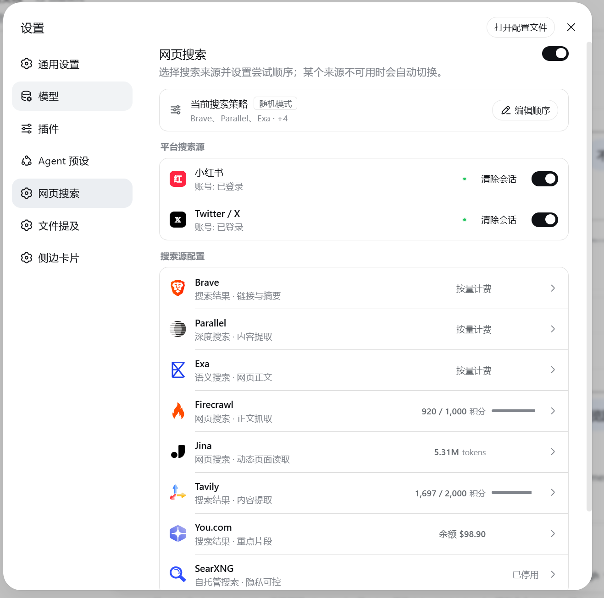

<div align="center">

<p align="center">
  
</p>

# dsh-web-tools

**为 DeepSeek Harness (DSH) 与 MCP 客户端提供稳定、好用的联网搜索与网页阅读能力**

多搜索源自动故障切换 · 自定义搜索接口接入 · 长网页按需精读 (`web_read`) · 小红书 / X 本地浏览器直连 · 独立 MCP 服务

<p align="center">
  <a href="https://github.com/A3Boy/dsh-web-tools/releases">
    
  </a>
  <a href="LICENSE">
    
  </a>
  
  
</p>

[English](README.md) | **简体中文** · [中文更新日志](CHANGELOG.zh-CN.md)

</div>

---

> [!WARNING]
> **小红书与 Twitter / X 账号安全提醒**
> 小红书检索会直接驱动你本地登录的浏览器窗口执行搜索、滚动和翻页。平台对自动化操作有严格风控，**高频或连续调用存在账号被限流甚至封禁的风险**。请务必**使用小号登录、控制检索频率、谨慎使用**；Twitter / X 同样受账号访问速率限制影响。不使用社媒检索时，可在设置页随时关闭对应平台开关。

## 它解决什么问题？

给大模型接联网工具时，最容易踩这几个坑：

1. **只接一家 API 容易断**：Key 额度用完、遇到 429 限流或网络抽风，整轮对话就直接报错。
2. **国内/自建接口不好接**：想用智谱、博查、自建 SearXNG 或公司内网检索接口，默认没入口，还得自己改代码。
3. **长网页把上下文塞爆**：直接 `web_fetch` 抓一篇几万字的技术文档，Token 消耗大，模型还容易看漏重点。
4. **社媒内容搜不到**：普通搜索引擎拿不到小红书笔记详情、评论区讨论或 X 推文上下文。

`dsh-web-tools` 把这几件事打包做好了：

- **三个现成工具**：`web_search`（联网搜索）、`web_fetch`（抓整页正文）、`web_read`（只挑和问题相关的段落 + 目录大纲）。
- **10 家内置搜索源 + 自定义接口**：支持 Exa、Tavily、Serper (Google)、Brave、Firecrawl、Keenable、You.com、Jina、Parallel、SearXNG；也支持直接在设置面板里配置**智谱 Web Search**、**博查**、Elasticsearch 或任意 JSON 搜索接口。
- **失败自动换源 & 多 Key 轮换**：一家超时、限流或没搜到结果，自动切下一家；同一个源可以填多个 API Key 轮流用。
- **既能当 DSH 插件，也能当独立 MCP 服务**：除了在 DSH Web 里开箱即用，还自带 `dsh-web-tools-mcp` 命令行服务，Cursor、Claude Code、Claude Desktop、Windsurf 都能直接接入。

---

## 快速上手

### 方式一：在 DeepSeek Harness (DSH) 中安装

```bash
# 安装插件
dsh plugin --profile web add github:A3Boy/dsh-web-tools

# 后续更新到最新版
dsh plugin --profile web update dsh-web-tools
```

安装完成后重启 `dsh web`，打开左侧 **设置 (Settings) → 网页搜索 (Web Search)**：

1. 点开你有的搜索源，填入 API Key（自建 SearXNG 默认不需要填 Key）。
2. 如果想接国内接口（如智谱、博查），点击列表右上角 **「添加自定义搜索源」**，顶部选对应预设模板，填好 Key 点「测试搜索」即可保存。
3. 在「当前搜索策略」里可以拖动调整优先顺序，或切换调度方式。

**对话里的常用操作：**
- **切换联网模式（快捷键 `Alt+S` 或输入 `/search`）**：
  - **智能联网（默认）**：模型自己判断要不要查网，闲聊和写本地代码不乱搜，需要核实最新信息时自动搜。
  - **始终联网**：每轮回答前至少调用一次联网工具。
  - **关闭联网**：从当前会话彻底移除联网工具并拦截调用，适合纯本地保密对话（重开历史会话也会保留你上次设好的开关状态）。
- **搜小红书 / X**：在问题前加 `小红书:` 或 `X:`（例如 `小红书: 京都三天两夜清静路线`），就会走本地社媒会话检索（**小红书请务必用小号、低频使用**）。

<p align="center">
  
</p>

---

### 方式二：作为独立 MCP 服务接入（Cursor / Claude Code 等）

不装 DSH 也能单独使用。因为包托管在 GitHub，直接通过 GitHub 地址安装或克隆构建即可：

```bash
# 方式 A：通过 GitHub 全局安装
npm install -g github:A3Boy/dsh-web-tools
dsh-web-tools-mcp

# 方式 B：克隆仓库本地构建
git clone https://github.com/A3Boy/dsh-web-tools.git
cd dsh-web-tools
npm install && npm run build
node bin/mcp-server.js
```

#### Cursor / Claude Desktop 配置示例

在 `.cursor/mcp.json` 或 `claude_desktop_config.json` 中添加（挑你有的 API Key 填即可，不用全填）：

```json
{
  "mcpServers": {
    "web-tools": {
      "command": "dsh-web-tools-mcp",
      "env": {
        "TAVILY_API_KEY": "tvly-...",
        "EXA_API_KEY": "...",
        "SERPER_API_KEY": "...",
        "WEB_TOOLS_DEFAULT_PROVIDER": "tavily",
        "WEB_TOOLS_ROUTING_POLICY": "adaptive",
        "WEB_TOOLS_RETRIEVAL_STRATEGY": "hedged"
      }
    }
  }
}
```

如果使用源码方式运行，把 `"command": "dsh-web-tools-mcp"` 换成 `"command": "node", "args": ["/你的路径/dsh-web-tools/bin/mcp-server.js"]` 即可。

#### Claude Code 一键添加

```bash
claude mcp add web-tools -- dsh-web-tools-mcp
```

---

## 主要功能说明

### 1. 网页精读 (`web_read`)：读长文不爆上下文

遇到几万字的长文档（比如 RFC 规范、框架官方文档、长篇博客），`web_fetch` 会把整页全塞给模型；而 `web_read` 只在本地做轻量切块和 BM25 关键词相关性打分（不额外调大模型，几毫秒算完）：

- **第 1 步（带着问题找重点）**：调用 `web_read(url, focus: "WAL 检查点怎么触发")`，返回最相关的几段原文 + 整篇文章的章节目录（如 `s0`、`s1`、`s2`）+ 页面指纹 `contentId`。
- **第 2 步（按章节展开细看）**：如果模型看目录后想通读某一节，再调 `web_read(url, section: "s2", contentId: "...")` 就能把这一节完整读出来；万一网页中途刷新改版了，`contentId` 校验会提醒模型重新拉目录，不会读错行。
- 如果网页本身很短（默认预算 6,000 字符以内），`web_read` 会直接返回全文，不瞎裁切。
- 不想启用这个工具时，可以在设置页「连接测试与超时」折叠面板里随时关掉 `web_read` 开关。

### 2. 多源调度与并发模式

在设置页点「编辑」搜索策略，可以按自己的预算和速度要求组合：

**每次怎么发请求（并发检索模式）：**
- **单源（默认，最省额度）**：先调第一家；报错、超时或 0 结果时再试下一家。
- **对冲（兼顾速度与额度）**：第一家发出后如果 **1.2 秒**还没回来，同时向第二家发请求；谁先返回就用谁，并立刻取消较慢的那一路。平时快请求只花 1 份额度，遇到卡顿时不用干等。
- **融合（查资料更全，耗双倍额度）**：同时查两家搜索源，用 RRF 算法把两边结果去重合并。

**先挑哪一家开始查（起始路由策略）：**
- **顺序**：严格按你排好的列表从上往下试。
- **轮询 / 随机**：把请求均匀分摊给多个可用源。
- **自适应**：根据最近 24 小时的成功率和响应耗时自动把稳又快的源排前面。
- **最快优先 / 最省优先**：按实测平均延迟排，或者优先用免费自建 SearXNG 再用付费 API。

此外，搜索词里的年份/`最新`、`site:github.com`、`-site:csdn.net`、代码/论文主题、按时间/点赞排序等意图，会在本地自动转换成各家 API 自己的原生过滤参数，不额外消耗模型调用。

### 3. 自定义搜索源（支持国内 API 与内网接口）

点击 **「添加自定义搜索源」**，内置了 6 个一键模板，点一下就能填好请求格式和字段映射：

1. **智谱 Web Search (BigModel)**：`open.bigmodel.cn` 标准搜索接口，填 Bearer Key 即用。
2. **博查 Web Search (Bocha)**：`api.bochaai.com` 联网搜索接口，自带摘要字段映射。
3. **Serper (Google)**：实时 Google 搜索结果。
4. **SearXNG**：自建开源元搜索实例。
5. **Elasticsearch / OpenSearch**：预置 `/_search` 的 `multi_match` JSON 请求体模板。
6. **Tavily 兼容网关**：兼容标准 Tavily `/search` 协议的中转服务。

如果你的内部接口格式比较特别，切到「自定义 JSON 接口」即可手动指定请求头、JSON 请求体模板（支持 `{{query}}`、`{{maxResults}}`、`{{apiKey}}` 占位符）以及返回结果的字段路径（如 `data.items`）。

**安全边界：**
- 自定义源的每次直连都会先校验 DNS 并钉死目标 IP、协议和端口，重定向（3xx）直接拒绝，防止 API Key 泄露给第三方或遭受 DNS 重绑定攻击。
- 访问局域网/本机地址或明文 `http://` 时会弹窗让你显式确认授权；云主机元数据地址（`169.254.169.254` 等）一律硬拦截。
- 支持读取环境变量代理（`HTTPS_PROXY` / `HTTP_PROXY`）、Windows 系统代理以及 `NO_PROXY` 白名单；局域网授权地址会自动直连，不绕外部代理。

### 4. 小红书与 Twitter / X 本地会话检索

- **免装额外浏览器**：直接通过 CDP 协议复用你电脑上已经装好的 Edge 或 Chrome，使用独立配置目录（`~/.dsh/web-tools/browser-profiles/<platform>`），跟你的日常浏览器互不干扰，Cookie 只留在你本机浏览器目录里。
- **小红书**：支持按综合、最新、最多点赞/评论/收藏搜索笔记，抓取笔记正文、图片与评论区内容。
- **Twitter / X**：已登录时走本地浏览器抓取完整推文、原图视频与回复树；未登录或浏览器受限时，单条推文链接会自动尝试公开接口兜底获取正文与基础互动数据。

> [!CAUTION]
> **再次提醒**：小红书风控对自动化翻页和高频搜索非常敏感，**请务必用小号登录并降低调用频率**，切勿拿主力大号做批量检索。

<p align="center">
  
</p>

---

## 内置搜索源一览

| 搜索源 | 搜索 (`web_search`) | 抓取 (`web_fetch`) | 主要特点 | 用量展示方式 |
| :--- | :---: | :---: | :--- | :--- |
| **[Exa](https://exa.ai)** | 支持 | 支持 | 语义搜索强，适合查技术资料、论文和英文高质量内容 | 跳转官方控制台 |
| **[Tavily](https://tavily.com)** | 支持 | 支持 | 专为 Agent 设计的搜索与正文提取，支持搜索深度调节 | 官方接口实时同步 |
| **[Serper](https://serper.dev)** | 支持 | — | Google 搜索结果 + AnswerBox 直接答案卡片，响应快 | 跳转官方控制台 |
| **[Brave](https://brave.com/search/api/)** | 支持 | — | 优先调 LLM Context 接口拿高密度摘要，支持时效与地区过滤 | 响应头自动同步 |
| **[Firecrawl](https://firecrawl.dev)** | 支持 | 支持 | 擅长网页转干净 Markdown，支持代码/GitHub 与学术分类 | 官方接口实时同步 |
| **[Keenable](https://keenable.ai)** | 支持 | 支持 | 支持域名和发布日期范围过滤，自带 `/v1/fetch` 正文提取 | 响应头 + 本地账本 |
| **[You.com](https://you.com)** | 支持 | 支持 | 返回长片段高亮，支持域名优先加权 | 官方接口实时同步 |
| **[Jina](https://jina.ai)** | 支持 | 支持 | 支持 ReaderLM-v2 网页转 Markdown | 响应头尽力读取 |
| **[Parallel](https://parallel.ai)** | 支持 | 支持 | 支持按目标意图引导搜索与域名/时效过滤 | 跳转官方控制台 |
| **[SearXNG](https://docs.searxng.org)** | 支持 | — | 开源自建、免 API Key、无平台配额限制 | 自建实例无需计费 |

> **网页抓取保底机制**：调用 `web_fetch` 或 `web_read` 时，如果你配了支持抓取的云端源（如 Tavily、Exa、Firecrawl、Keenable）会优先用它；如果没配或者对方抓取失败，会自动回退到插件内置的本地抓取器（基于 Defuddle 提取正文，超 8,000 字自动在开头生成目录）。

---

## MCP 环境变量参考

使用独立 `dsh-web-tools-mcp` 服务时，可通过以下环境变量传入配置（同一个搜索源填多个 Key 用英文逗号 `,` 分隔即可自动轮换）：

| 环境变量 | 说明 | 默认值 |
| :--- | :--- | :--- |
| `EXA_API_KEY` / `TAVILY_API_KEY` / `SERPER_API_KEY` / `BRAVE_API_KEY` | 对应搜索源的 API Key | — |
| `FIRECRAWL_API_KEY` / `KEENABLE_API_KEY` / `YOU_API_KEY` / `JINA_API_KEY` / `PARALLEL_API_KEY` | 对应搜索源的 API Key | — |
| `SEARXNG_URL` | 自建 SearXNG 实例地址（例如 `http://127.0.0.1:8080`） | — |
| `WEB_TOOLS_DEFAULT_PROVIDER` | 默认首选搜索源名称 | `exa` |
| `WEB_TOOLS_ROUTING_POLICY` | 起始路由策略：`ordered` / `round-robin` / `random` / `adaptive` / `fastest` / `cheapest` | `adaptive` |
| `WEB_TOOLS_RETRIEVAL_STRATEGY` | 并发检索模式：`single` / `hedged` / `fused` | `hedged` |
| `WEB_TOOLS_TIMEOUT_MS` | 单个搜索源的单次尝试超时（毫秒） | `10000` |
| `WEB_TOOLS_REQUEST_TIMEOUT_MS` | 单次 MCP 工具调用的总超时上限（毫秒） | `60000` |

---

## 常见问题 (FAQ)

### 1. 自建 SearXNG 报错 403 或者搜不到结果？
SearXNG 默认只开 HTML 网页输出，没开 JSON 接口。去你的 SearXNG `settings.yml` 里把 `json` 加上，重启容器就行：
```yaml
search:
  formats:
    - html
    - json
```
然后在插件里填地址（如 `http://127.0.0.1:8080`），API Key 留空。

### 2. 旧版升级上来遇到过 `unapproved authority <host>:0` 是怎么回事？
这是 `0.3.9` 里的一个传输层 bug：不带显式端口的自定义 HTTPS 地址（比如智谱 `https://open.bigmodel.cn/...`）被底层传成了空端口 `""`，旧代码误当成端口 `0` 拦掉了（手写 `:443` 也没用，URL 解析会自动把默认 `:443` 去掉）。升级到 **v0.5.1** 并重启 DSH 即可彻底解决，不需要改 Key 或调整权限。

### 3. 「智能联网」会不会每轮对话都往上下文里塞重复提示？
不会。**v0.5.1** 直接检查当前会话对模型可见的消息历史：只要智能联网说明还在上下文里（包括重启恢复历史会话），后续轮次都不会重复追加；只有当上下文压缩把早期消息清掉了，或者你刚从「始终联网 / 关闭联网」切回「智能联网」时，才会补一条。「关闭联网」在连续多轮对话里同样只提示一次。

### 4. 开启对冲或融合模式会不会很费额度？
- **单源 (`single`)**：正常一次只调 1 家，最省。
- **对冲 (`hedged`)**：主力源只要在 1.2 秒内正常返回，备选源根本不会启动；只有主力源卡住时才会并发兜底。
- **融合 (`fused`)**：每次固定同时查 2 家合并结果，消耗双倍额度，适合专门查资料时再开。

### 5. `web_read` 报 `WEB_READ_PAGE_CHANGED` 是什么意思？
说明模型在分章节读同一个网页的过程中，那个网页刚好在远端更新了内容，原来的章节号可能对不上了。插件拦住这次读取是为了提醒模型重新拉一次最新大纲，避免读串章节。

---

## 本地开发与测试

```bash
npm install          # 安装依赖
npm test             # 运行全部单元与集成测试
npm run typecheck    # TypeScript 类型检查（Host + Client）
npm run build        # 编译生成 lib/ 产物
npm run bench:m4     # 运行 web_read 基准评测（详见 bench/m4/RESULTS.md）
```

## 许可证

[MIT](LICENSE) © [A3Boy](https://github.com/A3Boy)
