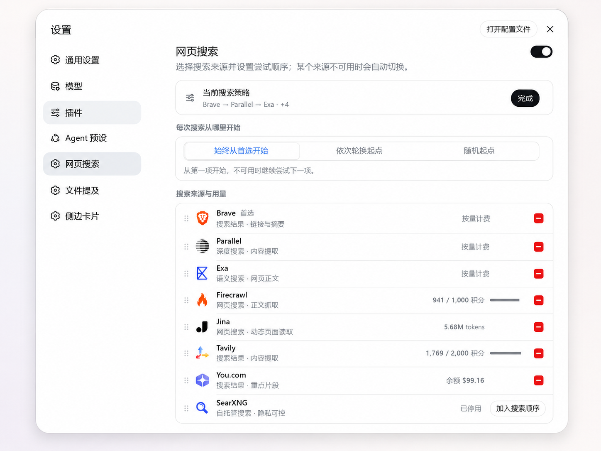
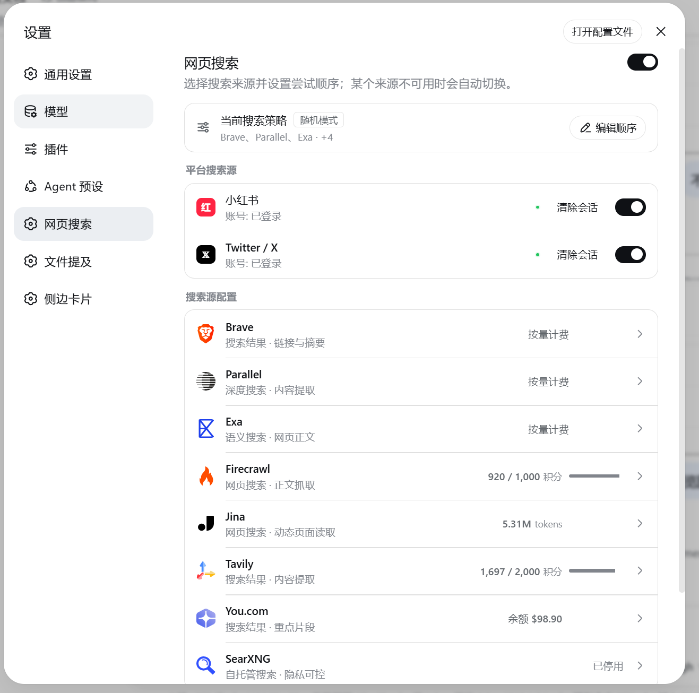

<div align="center">

<p align="center">
  
</p>

# dsh-web-tools

DeepSeek Harness 的全能智能联网与多源检索层。

**10 大搜索引擎原生特性 · 对冲与融合多源检索 · 小红书 / X 原生会话 · 独立 MCP 服务**

<p align="center">
  <a href="https://github.com/A3Boy/dsh-web-tools/stargazers">
    
  </a>
  <a href="LICENSE">
    
  </a>
  <a href="https://github.com/deepseek-ai/deepseek-harness">
    
  </a>
  
</p>

[English](README.md) | **简体中文**

</div>

## 版本历史 (Release History)

| 版本 | 发布日期 | 核心更新说明 |
| :--- | :--- | :--- |
| **v0.4.0** | 2026-11-09 | • **检索能力**：新增对冲（Hedged）与融合（Fused）并发检索，支持自适应与成本路由<br/>• **生态扩展**：支持独立 MCP 服务（适用于 Cursor / Claude Code），新增 Serper 适配<br/>• **体验优化**：超长网页自动大纲 (TOC)、输入框 `Alt+S` 快捷切换与启动提速 70% |
| **v0.3.9** | 2026-11-07 | 接入 Keenable 搜索引擎，支持 `site` 域名限定与发布日期过滤。 |
| **v0.3.5** | 2026-11-01 | 支持自定义搜索源（三条并列接入路径、JSON 请求体模板与分级出站防护）；支持小红书与 Twitter / X 专用浏览器会话原生检索。 |

完整更新履历请参阅 [CHANGELOG.md](CHANGELOG.md)。

---

## 为什么需要 dsh-web-tools？

在构建大模型 Agent 时，单纯依赖单一搜索 API 往往面临三个明显痛点：

1. **单点脆弱**：单一 API 额度耗尽、限流（429）或遇到网络抖动时，检索流程直接中断。
2. **能力被抹平**：许多多源方案只是将各 API 包装为最低公共参数，白白浪费了各家搜索源的独特优势（如 Exa 的语义分类、Brave 的 LLM Context、Tavily 的多级深度、Firecrawl 的 GitHub 筛选、Keenable 的摘要提取等）。
3. **社媒盲区**：传统搜索引擎难以触达小红书、Twitter / X 等强登录态社媒平台内的真实用户笔记与评论。

**dsh-web-tools 为此而生**：它无缝对接 DSH 原生的 `web_search` 与 `web_fetch` 工具，通过确定性的 **SearchHints** 将模型意图直接编译为各搜索源的原生参数；同时引入多 API Key 轮换、故障熔断、对冲/融合检索，并支持直连小红书与 Twitter / X 真实会话，构建起兼顾高可用、高性能与高信息密度的智能检索层。

```text
                         DSH Agent / MCP Client
                                   │
                        web_search / web_fetch
                                   │
                                   ▼
                              SearchHints
                 topic / freshness / domains / locale ...
                                   │
                 ┌─────────────────┴─────────────────┐
                 ▼                                   ▼
     Web Providers (10+ 原生适配)            社交媒体平台 (原生会话)
  Exa / Tavily / Firecrawl / Serper ...       小红书 / Twitter (X)
                 │                                   │
  ┌──────────────┼──────────────┐             (独立 Browser Profile)
  ▼              ▼              ▼                    │
单源顺序        对冲检索       多源融合            真实笔记 / 讨论树
(Single)       (Hedged)       (Fused)                │
  └──────────────┬──────────────┘                    │
                 ▼                                   ▼
         归一化优质检索结果与富文本正文 (支持长文自动 TOC 大纲)
```

<p align="center">
  
</p>

---

## 核心特性

- **10 大主流搜索引擎深度适配**：对 Exa、Tavily、Firecrawl、Parallel、Brave、You.com、Jina、Keenable、Serper (Google Search)、SearXNG 进行深度原生参数编译，拒绝功能降级。
- **高弹性多源并发检索**：
  - **单源 (Single)**：按配置依次尝试，故障平滑回退，最省配额。
  - **对冲 (Hedged)**：首选源响应迟缓（>1.2s）时自动并发唤醒备选源，先到先得并取消冗余任务，消弭长尾延迟。
  - **融合 (Fused)**：并发请求双源，采用倒数排名融合（RRF）合并去重，召回更全面。
- **6 大智能路由策略**：支持 **顺序**、**轮询**、**随机**，以及基于实测指标的 **自适应 (Adaptive)**、**最快 (Fastest)** 与 **最省 (Cheapest)** 路由。
- **小红书与 Twitter / X 平台直连**：基于本地浏览器专用 Profile 直连社媒平台，0 浏览器扩展、0 外部体积打包，安全解析真实笔记正文、图片信息与评论回复树。
- **长文档自动大纲目录 (TOC)**：内置提取器针对超长文档（超过 8,000 字符）自动提取 Markdown 层级并前置目录大纲，辅助大模型高效通读与精准定位。
- **页面精读 (`web_read`)**：基于确定性 BM25 算法的网页精读与结构化选段，在预算内仅返回最相关段落与结构大纲，支持 `section` 与 `contentId` 分节续读与防漂移，彻底避免超长网页灌入造成的上下文爆炸。
- **自定义搜索源与一键预设**：支持声明式接入企业内部私有知识库或任意 RESTful API，提供 Serper、SearXNG、Elasticsearch / OpenSearch 和 Tavily 兼容网关一键模板。
- **企业级出站防护 (SSRF Defense)**：公网安全放行、私网访问显式授权提示、底层硬核阻断云厂商元数据（169.254 / IMDSv6）与本地链路地址。
- **多级容灾与稳定性**：多 API Key 自动轮换与负载、429 冷却窗口、故障断路器、短周期结果缓存与并发合并，保障生产环境稳定。
- **独立 MCP Server**：检索内核完全解耦，支持以标准 stdio MCP 协议供 Cursor、Claude Code、Windsurf 等任意外部 Agent 调用。
- **会话级快捷控制**：输入框集成联网控制面板（智能联网、始终联网、完全断网），支持 `Alt+S` 快捷键极速切换。

---

## 快速上手

### 1. 安装插件

在 DSH 环境中运行：

```bash
# 安装插件
dsh plugin --profile web add github:A3Boy/dsh-web-tools

# 后续升级插件
dsh plugin --profile web update dsh-web-tools
```

### 2. 配置与启动

重启 DSH Web 实例（`dsh web`），在左侧导航栏点击：**Settings** → **Web Search**。

- 在搜索源列表中，填入你已有的任意 Provider API Key（如 Tavily、Exa、Serper、Brave 等，自建 SearXNG 无需 Key）。
- 勾选启用的搜索源，拖拽或调整 fallback 顺序。
- 点击任意源下方的「测试搜索」，即可实时验证网络连通性与检索耗时。

### 3. 会话中开箱即用

DSH 模型侧无需任何配置，正常提问即可触发联网检索：
- **快捷键切换**：在聊天输入框按下 `Alt+S`，可快速在「智能联网（按需）」、「始终联网（强求证）」与「关闭联网（硬隔离）」三档之间循环切换。
- **指定社媒检索**：在问题前加上 `小红书:` 或 `X:` 前缀（例如 `小红书: 杭州周末徒步路线推荐`），系统将自动导向社媒专用会话检索。

---

## 进阶功能与调度机制

### 1. 多源并发检索方式

在设置面板中，你可以自由选择一次搜索调度 Provider 的工作方式：

- **单源模式 (Single)**：默认行为。优先请求首选源，如果首选源遭遇网络故障、超时、429 或返回 0 条结果，自动降级至备选源。最节省配额。
- **对冲模式 (Hedged)**：首选源发出后，如果 1.2 秒内未返回，系统会自动唤醒第二顺位的备选源并行检索。哪一路先成功返回即采纳该结果，同时自动**取消**另一路未完成的请求。在快查询上零额外开销，在慢查询上彻底斩断 p95/p99 尾部延迟。
- **融合模式 (Fused)**：同时向两个健康的 Provider 发起并发检索，并使用 **RRF (Reciprocal Rank Fusion)** 算法对两组结果去重后重新排序，并在前端标注「融合结果」徽标。适合需要高召回率的深度研究场景。

### 2. 6 种起始路由策略

- **顺序 (Ordered)**：始终优先调用排列在第一位的首选源。
- **轮询 (Round-Robin)**：在多个已启用的搜索源之间均匀轮换初始请求。
- **随机 (Random)**：完全随机挑选健康的初始源。
- **自适应 (Adaptive)**：根据最近 24 小时的实际请求成功率与时延指标，动态优先调度最优搜索源（实测数据不足时平滑过渡到顺序模式）。
- **最快 (Fastest)**：优先选择实测平均响应时间最短的 Provider。
- **最省 (Cheapest)**：按成本档位优先调度（自建 SearXNG -> 普惠搜索 API -> 按量计费的深度抓取 API）。

### 3. 独立 MCP 服务 (适用于 Cursor / Claude Code)

本项目的检索内核已完全解耦。你可以脱离 DSH，将其作为独立的 stdio MCP Server 供任意现代 AI 编程助手使用：

```bash
# 全局安装后直接运行
dsh-web-tools-mcp

# 或在仓库源码目录下运行
npm install && npm run build
node bin/mcp-server.js
```

对外暴露 `web_search`（关键词搜索）、`web_fetch`（正文抓取）与 `web_read`（页面精读）工具。服务通过环境变量读取各 API 密钥（如 `EXA_API_KEY`、`TAVILY_API_KEY`、`SERPER_API_KEY` 等），支持通过 `WEB_TOOLS_ROUTING_POLICY` 配置路由策略。

---

## 页面精读 (`web_read`)

DSH 内置的 `web_fetch` 会将网页全文（默认上限可达 200,000 字符）完整灌入大模型上下文。对于长篇技术文档、API 手册或长文资讯，极易造成上下文爆炸与关键信息稀释。

**`web_read`** 通过确定性的纯算法 BM25 分块排序实现高信噪比精读：

- **确定性 BM25 相关性选段**：无额外 LLM 调用，通过中英双语分词与 BM25 算法根据 `focus`（目标问题）对段落排序，仅返回最相关的段落与整页大纲，严格限制在 `maxChars` 预算内。
- **目录式分节续读**：返回结果自带页面结构大纲。模型可基于大纲中的章节编号，传入 `section: "<id>"`（例如 `section: "s2"`）定向通读某一节。
- **内容防漂移保护 (`contentId`)**：输出带 8 位 Sha256 内容指纹 `contentId`。续读指定章节时校验指纹，若页面远端内容发生更新则主动提示重新获取大纲，杜绝段落漂移。
- **共享缓存与安全防护**：全面复用已有的 5 分钟抓取缓存与 SSRF 防护链路，多节连续阅读无需重复发起网络请求。
- **会话联网模式联动**：在搜索模式切换为 `off` 时，`web_read` 与 `web_search`/`web_fetch` 同步受控隐藏与拦截。

### 工具参数

| 参数 | 类型 | 必填 | 说明 |
| :--- | :---: | :---: | :--- |
| `url` | string | **是** | 目标网页地址（必须以 `http://` 或 `https://` 开头）。 |
| `focus` | string | 否 | 需针对解答的问题或关键词；省略时默认从文章开头阅读。 |
| `maxChars` | number | 否 | 返回字符预算（500–20,000，默认 6,000）。 |
| `section` | string | 否 | 上一次调用返回的大纲章节编号（如 `"s2"`），用于全文通读该章节。 |
| `contentId` | string | 否 | 上一次调用返回的内容指纹，用于防止网页动态变动导致章节漂移。 |

### 配置项

- `webReadEnabled`（布尔值，默认 `true`）：控制是否在 DSH 运行时注册 `web_read` 工具。

---

## 社交媒体检索（小红书与 Twitter / X）

区别于传统的第三方抓取代理，本插件采用**本地专用浏览器 Profile 架构**：

- **免安装外部打包**：直接复用本地 Edge 或 Chrome 浏览器，不需要额外下载巨大的 Chromium 或 Playwright 二进制，不安装任何第三方浏览器扩展。
- **独立凭证隔离**：账号登录状态保存在独立的本地数据目录中，Cookie 绝不写入配置文件或发送到第三方中转。
- **结构化深度解析**：
  - **小红书**：自动进入真实搜索框检索，支持笔记详情抓取，逐条解析多级评论与已返回的楼中楼回复。
  - **Twitter / X**：捕获客户端原生 GraphQL 数据流，结构化还原推文内容、转推、媒体与回复讨论树。

<p align="center">
  
</p>

---

## Provider 支持矩阵

| Provider | 网页搜索 (Search) | 网页抓取 (Fetch) | 原生特色与核心适配能力 | 配额与用量说明 |
| :--- | :---: | :---: | :--- | :--- |
| **[Exa](https://exa.ai)** | 支持 | 支持 | 神经网络语义检索、垂直分类映射、Query 高亮切片、ISO 日期范围与域名限制 | 控制台查询 |
| **[Tavily](https://tavily.com)** | 支持 | 支持 | 深度模式切换、分块控制、新闻/金融话题分类、国家与域名过滤 | 官方 API 实时查询 |
| **[Serper](https://serper.dev)** | 支持 | — | 实时 Google 搜索，支持 `answerBox` 快速解答、时效 `tbs`、地区语言与域名限制 | 控制台查询 |
| **[Firecrawl](https://firecrawl.dev)** | 支持 | 支持 | 技术查询映射 `github`、学术查询映射 `research`，支持 Clean Markdown 抓取 | 官方 API 实时查询 |
| **[Parallel](https://parallel.ai)** | 支持 | 支持 | 双层语义检索、`objective` 软引导意图、`source_policy` 域名/时效过滤 | 控制台查询 |
| **[Brave](https://brave.com/search/api/)** | 支持 | — | 优先使用 LLM Context 预提取摘要，支持时效/区域语言过滤 | 响应头自动捕获 |
| **[Keenable](https://keenable.ai)** | 支持 | 支持 | `site` 域名限定与发布时间过滤；原生 Markdown 页面抓取 (`/v1/fetch`) | 响应头与每次用量台账 |
| **[You.com](https://you.com)** | 支持 | 支持 | 搜索高亮片段提取、原生 `boost_domains` 域名软加权、时效与国家过滤 | 官方 API 实时查询 |
| **[Jina](https://jina.ai)** | 支持 | 支持 | 关键词降噪与 ReaderLM-v2 高精度 Markdown 转换 | 响应头尽力解析 |
| **[SearXNG](https://docs.searxng.org)** | 支持 | — | 开源自建元搜索，原生分类与时效过滤，免 API Key | 自建实例管理 |

> **网页抓取说明**：配置 Tavily、Exa、Firecrawl、Keenable 等支持抓取的源时，优先调用其云端抓取接口；若未配置或提取失败，插件会自动平滑回退至**内置通用抓取器**（基于 Defuddle 纯本地 Markdown 解析，超长长篇自动生成 TOC 大纲），保障内容始终可读。

---

## 常见问题 (FAQ)

### 1. 自建 SearXNG 提示 403 或无结果？
使用 Docker 或自建 SearXNG 时，请确保开启了 JSON 接口支持：
- 打开 SearXNG 容器中的 `settings.yml`，在 `search.formats` 下增加 `- json`：
  ```yaml
  search:
    formats:
      - html
      - json  # 必须包含，用于 API 请求
  ```
- 修改后重启容器生效。在插件面板中填写实例地址（如 `http://127.0.0.1:8080`），API Key 留空即可。

### 2. 为什么部分长网页阅读速度明显提升？
插件内置了超长内容自适应处理机制：当单篇网页正文超过 8,000 字符时，内置提取器会自动扫描文档标题并前置生成 Markdown 目录大纲（Table of Contents），帮助大模型第一时间纵览全文结构，大幅降低上下文检索幻觉。

### 3. 多源检索会消耗双倍额度吗？
- **单源 (Single)**：只有在首选源报错或无结果时才会尝试第二源，正常情况下仅消耗单份配额。
- **对冲 (Hedged)**：首选源响应快（<1.2s）时第二源从不启动；仅当首选源超时卡顿时才启动双路，且先返回者会立即终止对方，最大化控制配额损耗。
- **融合 (Fused)**：会并发请求两家搜索源以换取更全的召回与重排结果，会消耗双份配额。

---

## 本地开发与测试

```bash
npm install          # 安装依赖
npm test             # 运行 520+ 单元与集成测试套件
npm run typecheck    # 严格 TypeScript 类型检查
npm run build        # 构建输出至 lib/ 目录
```

---

## 许可证

[MIT](LICENSE) © A3Boy
